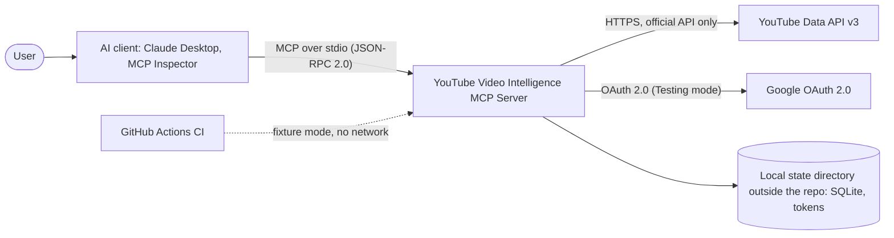
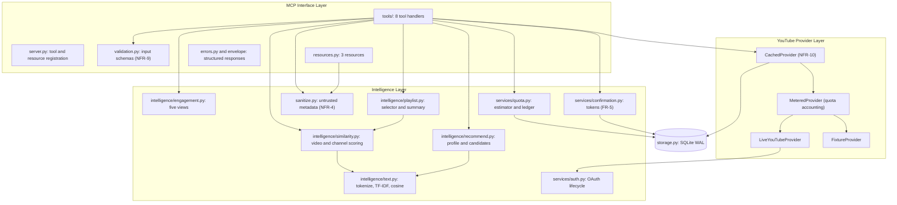
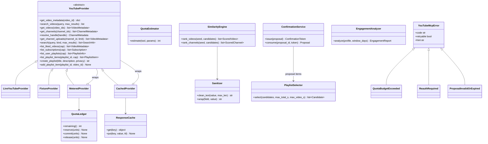
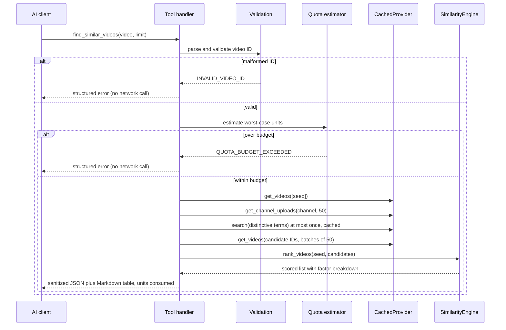
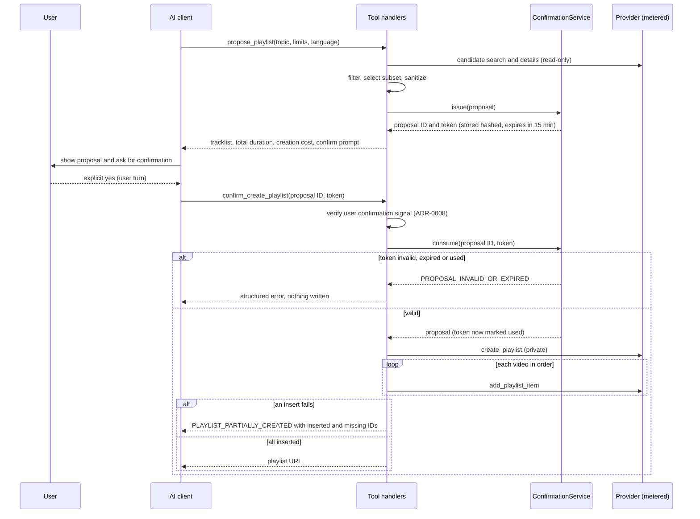
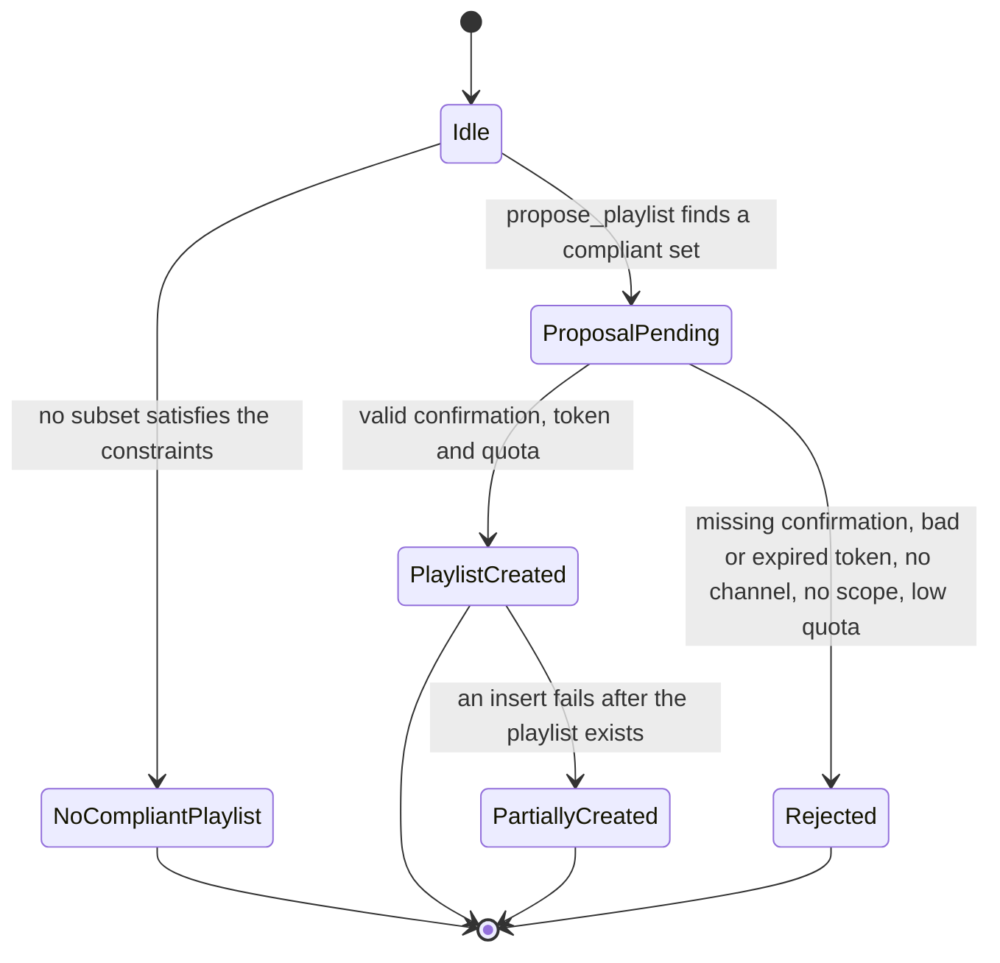
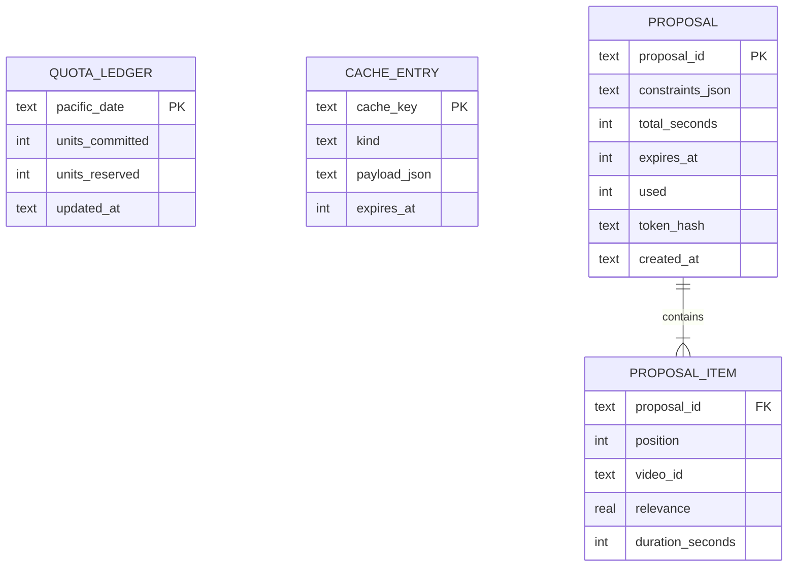

# System Architecture and Design — YouTube Video Intelligence MCP Server

Stage 2 deliverable (SE-2). Baseline: SRS v1.5.0. Diagrams use Mermaid and render on GitHub.
Decisions behind this design are recorded in `docs/adr/` (ADR-0002 to ADR-0011); research is in
the second brain (`brain/`). Where this document proposes values the SRS leaves open, they are
marked **Proposed** and are confirmed or changed in Stage 3 against fixtures.

## 1. Purpose and scope
The server lets an MCP client call 8 tools and read 3 resources to discover, analyse and curate
YouTube videos for an authorised user (FR-1 to FR-5), using only the official YouTube Data API v3.
This document describes how the SRS requirements are realised: layers, modules, data stores,
runtime interactions and the error model. It does not contain code.

## 2. Architectural drivers
| Driver | Requirement | Design consequence |
| :--- | :--- | :--- |
| No YouTube calls in CI | NFR-1, NFR-6, TQ-5 | All API access behind `YouTubeProvider`; `FixtureProvider` serves recorded JSON |
| 10,000 units/day | NFR-2, SAF-1, TQ-6 | Pre-flight estimator + persistent quota ledger; reject before any call |
| Repeat calls must be free | NFR-10 | Cache decorator with TTLs; hits cost 0 units |
| Hostile metadata | NFR-4, SEC-4 | One sanitizer for all untrusted text; confirmation is server-side state |
| No unconfirmed writes | SAF-2, SAF-3, REQ-5.3/5.4 | Two-step propose/confirm with signed single-use token |
| Least privilege | NFR-3, SEC-1 | Read tools request `youtube.readonly`; write scope only on confirm |
| Determinism | REQ-1.5, NFR-8 | Pure-Python scoring, stable tie-breaks, no randomness in ranking |
| Structured errors | NFR-5, section 6.4 | One exception hierarchy mapped to the 15 SRS error codes |

## 3. System context


## 4. Layered component view

Dependency rule: the Intelligence Layer never imports a concrete provider; it receives a
`YouTubeProvider` instance. Only `server.py` chooses `live` or `fixture` (from
`YOUTUBE_PROVIDER_MODE`).

## 5. Planned package layout (Stage 3)
```
src/youtube_mcp/
  server.py          MCP wiring and stdio entry point
  config.py          environment loading (section 12)
  errors.py          YouTubeMcpError hierarchy and error codes
  models.py          VideoMetadata, ChannelMetadata, Proposal, ... (dataclasses)
  validation.py      ID/URL parsing and parameter validation
  sanitize.py        control-character stripping, truncation, data boundaries
  storage.py         SQLite connection (WAL), schema creation
  resources.py       youtube://video/{id}, youtube://channel/{id}, quota://status
  tools/             one module per MCP tool
  intelligence/      text.py, similarity.py, recommend.py, engagement.py, playlist.py
  services/          quota.py, cache.py, confirmation.py, auth.py
  providers/         base.py (exists), live.py, fixture.py, metered.py, cached.py
```
Only `providers/base.py` exists today; everything else is Stage 3 work (`docs/dev-plan.md`).

## 6. Class model

`get_video_metadata` and `search_videos` are the two methods that exist today in
`providers/base.py`; they are kept so the Stage 1 smoke test remains valid (ADR-0002).

## 7. Provider contract and quota cost
| Provider method | YouTube endpoint | Units | Auth |
| :--- | :--- | :--- | :--- |
| `get_videos` (<= 50 IDs) | `videos.list` | 1 | API key |
| `get_channels` / `resolve_handle` | `channels.list` (`id` / `forHandle`) | 1 | API key |
| `get_channel_uploads` | `playlistItems.list` on the uploads playlist | 1 per page | API key |
| `search` | `search.list` | 100 | API key |
| `list_liked_videos` | `videos.list` (`myRating=like`) | 1 per page | OAuth `youtube.readonly` |
| `list_subscriptions` | `subscriptions.list` | 1 per page | OAuth `youtube.readonly` |
| `list_user_playlists` | `playlists.list` | 1 per page | OAuth `youtube.readonly` |
| `list_playlist_items` | `playlistItems.list` | 1 per page | OAuth `youtube.readonly` |
| `create_playlist` | `playlists.insert` | 50 | OAuth `youtube` write scope |
| `add_playlist_item` | `playlistItems.insert` | 50 | OAuth `youtube` write scope |
Costs are from SRS section 2.5. `SearchHit`, `Subscription`, `PlaylistInfo` and `PlaylistItem`
are small dataclasses defined in `models.py` in Stage 3.

## 8. Tool to module to quota map
| Tool | Feature | Main modules | Worst-case units (SRS 2.5, planning) |
| :--- | :--- | :--- | :--- |
| `get_video_details` | REQ-1.7 | validation, sanitize, provider | 1 |
| `find_similar_videos` | FR-1 | similarity, text, provider, cache | ~104 |
| `find_similar_channels` | FR-2 | similarity, text, provider, cache | ~123 |
| `recommend_videos` | FR-3 | recommend, text, auth, provider | ~160 |
| `analyze_engagement` | FR-4 | engagement, auth, provider | ~60 |
| `propose_playlist` | FR-5 step 1 | playlist, similarity, confirmation | ~103 |
| `confirm_create_playlist` | FR-5 step 2 | confirmation, auth, provider | 50 + 50 x N |
| `analyze_playlist` | REQ-5.5 | playlist, auth (private only) | 0 for a proposal, ~2 for a playlist |
Estimates are the SRS planning numbers; the estimator (ADR-0004) computes the exact worst case
per request before any call.

## 9. Runtime behaviour
### 9.1 find_similar_videos (FR-1)

### 9.2 Propose and confirm a playlist (FR-5)

### 9.3 OAuth re-authorisation
A missing, expired or revoked token raises `ReauthRequired` (code `REAUTH_REQUIRED`). The tool
returns the structured error with a hint to re-run the sign-in command; the server never opens a
browser from inside a tool call. Tokens in Testing mode last 7 days (ADR-0010).

## 10. FR-5 state model

Matches SRS Appendix B.2. A token is consumed immediately before the first write.

## 11. Data model (local SQLite, WAL mode)

Rationale and alternatives: ADR-0005 and `[[RN-11-quota-ledger-and-cache-storage-design]]`.
The OAuth token file and the signing secret are separate files outside the repository with
owner-only permissions (ADR-0010). Cached payloads contain public video metadata only; user
profile data cached for 1 hour is stored in the same table with `kind = profile` and is never
logged (NFR-10).

## 12. Configuration (environment variables)
| Variable | Meaning | Default |
| :--- | :--- | :--- |
| `YOUTUBE_PROVIDER_MODE` | `fixture` or `live` | `fixture` |
| `YOUTUBE_API_KEY` | API key for public tools | none |
| `YOUTUBE_CLIENT_SECRET_PATH` | OAuth client file, outside the repo | none |
| `YOUTUBE_TOKEN_PATH` | OAuth token file, outside the repo | none |
| `YOUTUBE_DAILY_QUOTA_LIMIT` | Daily budget in units | `10000` |
| `YOUTUBE_MCP_HOME` (**Proposed**) | State directory for SQLite and signing secret | per-user data dir |
| `YOUTUBE_CONFIRM_TTL_SECONDS` (**Proposed**) | Proposal lifetime | `900` |
The first five exist in `.env.example`; the last two are added in Stage 3.

## 13. Error model
`YouTubeMcpError` carries `code`, `message`, `retryable` and `hint`. Every code in SRS 6.4
has exactly one subclass; tools never let a raw exception escape (NFR-5). The response envelope
for failures is `{"ok": false, "error": {"code", "message", "retryable", "hint"}}`
(`docs/api-reference.md`). Mapping from YouTube reasons: `quotaExceeded` to `QUOTA_EXCEEDED`;
`youtubeSignupRequired` to `YOUTUBE_CHANNEL_REQUIRED`; HTTP 429 after 3 backoff retries to
`RATE_LIMITED`; persistent 5xx to `UPSTREAM_UNAVAILABLE`; `invalid_grant` or a missing token to
`REAUTH_REQUIRED`; a missing video in a `videos.list` response to `VIDEO_NOT_FOUND_OR_PRIVATE`.

## 14. Per-feature design summary
| Feature | Design |
| :--- | :--- |
| FR-1 | Seed details, 50 latest uploads of the seed channel and at most one cached keyword search give candidates; score = text 0.60 + category/topic 0.25 + duration 0.15 (ADR-0006) |
| FR-2 | Candidate channels from one cached search; score = text 0.50 + shared topics 0.30 + cadence 0.10 + average duration 0.10 (ADR-0006) |
| FR-3 | Profile of terms, topics and duration range from likes, subscriptions and playlists; candidates from subscribed channels' uploads; exclude liked/saved videos |
| FR-4 | Five views over the current and previous window; timestamp source per ADR-0011 (**Proposed**, TBD-3) |
| FR-5 | Hard filters, then bounded knapsack selection (ADR-0007), then token (ADR-0008); writes only after confirmation |

## 15. Requirement-to-design traceability
Full matrix: `docs/traceability.md`. Highlights: NFR-1 to sections 4 and 7; NFR-2 to sections 8
and 11; NFR-3 to 9.3 and 12; NFR-4 to the Sanitizer in sections 4 and 6 (ADR-0009); NFR-5 to
section 13; NFR-10 to sections 4 and 11; SAF-2 and SAF-3 to sections 9.2 and 10.

## 16. Open design questions (to resolve in Stage 3)
1. TBD-3: do liked-video entries carry a usable like time? (ADR-0011)
2. Which MCP confirmation mechanism does the demo client support? (ADR-0008, DEP-2)
3. Windows cannot enforce POSIX `0600`; the Windows protection for token files is verified in a
   Stage 3 spike (ADR-0010).
4. Final scoring weights are tuned against fixtures; the SRS fixes only their order.
